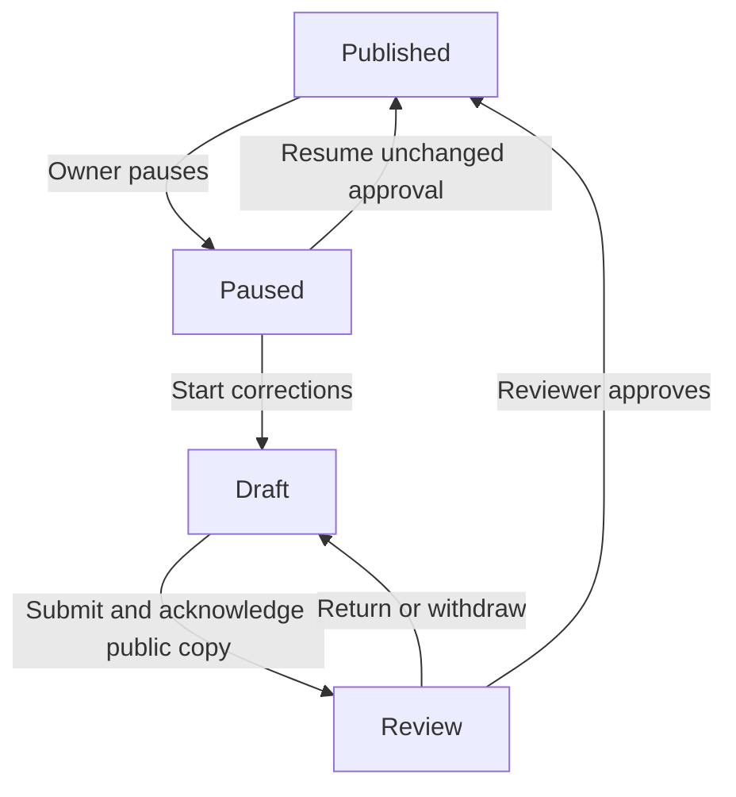

# Published listing controls and corrections proposal

**Status:** accepted on 30 October 2026; implementation is split into A (visibility) and B (offline corrections). This decision document is not execution evidence.
**Responsible role:** project owner (policy); technical maintainer (implementation).
**Last source verification:** 30 October 2026, main [42e8c29](https://github.com/kimsourly1912/root-of-cambodia/commit/42e8c294cacc3a1658d2447cfb8825d9305a911a).

**Sources:** [accepted scope](scope.md), [open decisions](open-decisions.md), [publication service](../../packages/backend/src/publication.ts), [publication persistence](../../packages/backend/src/publication-persistence.ts), [snapshot/read model](../../packages/backend/src/publication-queries.ts), [public reader](../../packages/backend/src/catalog-queries.ts), [public-boundary ADR](../architecture/decisions/0005-public-listing-boundary.md), [booking disclosure ADR](../architecture/decisions/0006-booking-journey.md).

## Where we are and why this step matters

PR #31 is merged. Owner setup, manual publication review, public browsing, guest/owner booking screens, ordinary stays/payment records, operational stock edits, external reservations and status-filtered owner lists have local/CI evidence. Step 6 remains incomplete; staging/live providers and pilot readiness are not established.

Published listings currently show the immutable copy approved by the reviewer, with the owner's exact public-display acknowledgement. Most content, price/calendar setup and photo/logistics writes require draft state. The separate operational inventory action can update configured capacity/blocked counts across states. The publication state supports paused, and public reads already exclude it, but there is no owner pause/resume or reopen-for-correction product action. Existing tests' trusted SQL state changes are not an owner workflow or approval for one.

The owner's continuation authorizes preparing this concrete next decision. It does not by itself settle D05 or approve the new publication transitions below. This proposal preserves the existing Next.js/shadcn, shared backend and atomic D1 architecture; no vendor, framework, service cost, live deployment or general admin powers are introduced.

## Recommendation and alternatives

Recommend two independently reviewable implementation slices after agreement:

1. **A — pause/resume an unchanged approved listing.** Let the current verified owner stop new public discovery/requests and later restore the same approved listing.
2. **B — take the listing offline, correct it, then submit for fresh review.** Reuse the existing draft editors and manual approval. Updated content returns publicly only after explicit owner acknowledgement and reviewer approval.

| Approach | Owner effect | Complexity, maintenance and safety |
| --- | --- | --- |
| Recommended: offline correction plus fresh review | Listing is unavailable to new guests during editing and review | Reuses one catalog, existing editors, snapshots and review; slower return to market, simpler pilot operation |
| Keep approved content live while a parallel draft is reviewed | New guests can continue requesting the old version until replacement approval | Needs separate editable catalog/version relationships and careful atomic switching of room, rate, photo and booking references; more schema, UI and migration work |
| Publish edits immediately without review | Fastest owner changes | Would bypass the selected manual-review boundary; not recommended for the pilot |

Requiring review for all supported corrections is a deliberate conservative pilot recommendation, not an already approved permanent policy. A later minor-edit exemption or live parallel draft needs its own decision.

## Proposed state transitions

Published owners pause first before starting corrections. Draft and Review cannot use Resume. Starting corrections deliberately ends the direct resume path to the prior approval, even if the owner makes no edits. There is no silent discard-and-restore-old-version operation in this proposal. The UI must explain that a fresh review will be required before confirming that step.

### Slice A: pause and resume

- Pause is an explicit current verified-owner action on a Published property. It changes visibility only. Subsequent anonymous list/detail/processed-photo reads and new online quote/submission paths refuse the paused listing; write-time booking checks must fence a concurrent pause.
- Existing Pending/Confirmed/Checked-in/Completed and other booking records remain accessible to their authorized actors. Pause does not cancel requests, extend response deadlines, release stock, clear payment records or change prices. Existing actions remain subject to their ordinary rules. Operational availability and anonymous external-reservation records remain available to the owner under their existing contracts.
- Resume applies only to an owner-paused, unchanged approval. Recheck current verified ownership, the latest approved request, public-display evidence/digest, matching approved property terms and required approved-media metadata. Historical paused rows without evidence that this owner-control workflow paused them fail closed; do not reinterpret an unknown pause as owner permission or bypass a future moderation hold.
- Resume does not create a review, replace its immutable snapshot or broaden public fields. Do not compare the full current private snapshot byte-for-byte to the pre-approval snapshot: approval changes terms, and legitimate stock/calendar operations can change operational summaries. Eligibility should share the existing public approval/evidence predicates, with the state condition adapted explicitly for this guarded transition.
- Do not add calendar age, fully reserved/blocked stock or current reviewer assignment as automatic revocation rules. Existing public eligibility intentionally does not treat them that way. Current guest terms-document/configuration and full-stay price/stock checks continue to gate new booking requests; resume is not permission to invent legal terms or bypass them.
- No arbitrary state setter, owner delete/unpublish action, automatic resume or reviewer/support suspension action is included. Pausing cannot recall information already downloaded.

### Slice B: corrections after pause

- A separate explicit Start corrections action changes an eligible owner-paused property to Draft, leaves it absent from new public reads/requests and invalidates direct resume of the old approval.
- Reuse only supported existing draft editors: basics/booking settings already editable there, description/address/facilities, private location/contact/arrival details, room settings, initial dated rates/stock and gallery management. This does not add a charges editor, physical-unit management, extra guest fields, an admin editor or any currently unsupported field.
- Keep the same property and stable room/booking identities. Never clone, hard-delete, repoint or replace records referenced by bookings to make an edit work. Preserve immutable submitted prices, dates, occupancy, room lines, policies, terms, acceptance logistics and required event/receipt history. Existing stock constraints remain authoritative during calendar or room edits.
- Recheck that an older review snapshot does not prevent legitimate inventory operations on existing bookings. Snapshot integrity and new-content review must not be bypassed to solve a compatibility problem; stop and report a material conflict before expanding scope.
- Submit the corrected saved draft with a new exact public preview and explicit public-display acknowledgement. Reapply the existing minimum checklist, immutable review snapshot, configured reviewer and approved terms gates. Withdrawal/return goes back to the offline draft. Only new manual approval publishes the correction.
- Existing approved review rows and acknowledgement/event/receipt history stay immutable. The new review becomes the latest submission. Old successful pause/resume/correction receipts describe their original outcomes; replay must not reapply an old transition after a later correction.
- Changes do not silently rewrite Pending quotes or existing Confirmed guests' acceptance-time arrival instructions. For example, correcting a reception email does not update the saved contact shown on an existing Confirmed booking. A safe instruction-correction/guest-notification workflow remains separate D06/D07/D17 work; no notification is claimed here. This limitation must be visible before owners save logistics corrections.
- Existing photo removal, tombstones and private processing rules still apply; this proposal neither promises permanent media-byte retention nor creates a destructive cleanup policy. Review history is not proof that removed bytes remain available. D09 stays open.

## Proposed architecture and recovery

Keep thin private web adapters and owner pages, framework-independent service validation/authorized reads, and one named atomic D1 save for each visibility transition. Preserve the accepted modular monolith and booking engine.

A small additive listing-control record/event extension should track the control revision, desired action, approving request identity and attributable owner command. Reuse the existing owner operation key/fingerprint/receipt mechanism where compatible; do not add owner visibility actions to the reviewer-only command vocabulary or mutate terminal review rows. Final schema/constraints and ordered migration details belong in each implementation PR, with fresh and populated-upgrade proof. Do not rewrite applied migrations or fabricate prior control/consent events during migration.

Expected state, control revision and approved request identity protect two open tabs and stale controls. Repeat current verified ownership and all required approval/state guards at commit. State, control/event/revision and success receipt must commit together; a missing audit event or zero-row transition rolls everything back. The control design must observe reopening/review/approval cycles so an earlier Resume cannot be replayed against a newer approval.

Use an explicit desired-state action rather than Toggle. Freeze the key/body while an outcome is uncertain. Retry the same operation; a successful old receipt is followed by a fresh authorized state read and never reruns its effect. Private payloads are not persisted in browser storage. The first slice may preserve an uncertain attempt only in its open tab, like current publication controls; disclose this limit and provide latest-state reload after navigation, without claiming durable unsent-intent recovery. Reload is a read, not an automatic reissue under a fresh key.

Public/media reads retain their before/after eligibility fencing and no-store behavior. An in-flight reader that observes pause, changed approved request or invalidated ownership must fail closed. D1 cannot revoke already delivered bytes, and D1/R2 still have no cross-service transaction. No public bucket/CDN invalidation or live provider change is selected.

## Proposed screens and acceptance

Use the existing property area to show current publication state and clear actions. Published shows Pause; owner-paused shows Resume unchanged listing and Start corrections; Draft links to setup/submission; Review exposes the existing withdrawal/status flow. Confirm the public/bookings effect before writes. A paused row with no recognized owner-control history must explain that self-service resume is unavailable rather than showing a working action.

The server controls available actions; UI buttons are convenience only. Keep pre-hydration write controls disabled. Cover saving, saved, empty/missing approval, stale revision/changed owner, session recovery and uncertain same-action retry. Never show an unavailable network result as confirmed success.

| Verification layer | Required evidence before calling a slice locally tested |
| --- | --- |
| Native Workers/D1 | Verified owner isolation; current/commit-time revocation; exact legal transitions; approval/media/terms evidence; stale tabs and competing commands; no side effects on refused writes; required event/receipt rollback |
| Migration/replay | Fresh install and populated 0018 upgrade preserve all existing records; no backfilled control consent; original booking/review receipts replay; old visibility receipts cannot republish a corrected/review-pending listing |
| Booking invariants | Pending deadlines and existing actions preserved subject to existing rules; stock/price/snapshots/payment unchanged by visibility commands; new quote/submission refused across a concurrent pause; existing-booking writes remain atomic through correction/review |
| Public/media privacy | List/detail/photo unavailable after pause/reopen; resume only the intended approval; wrong-owner/old-unconfirmed/unknown-origin-paused rows stay unavailable; storage-access pause/revision races fail closed; no private fields/originals |
| Built Worker | Actual sessions/Origin/JSON/private-cache transport; same-key recovery, strict input and safe errors; no provisioning or fixture endpoint bundled |
| Matching desktop/phone | Pause/reload/hidden public reads, unchanged booking access, resume, stale tabs/lost response, then offline correction/new acknowledgement/review/republication with changed approved values and no overflow |

Use the existing Vitest and Playwright setup and preserve prior assertions. These are proposed checks, not results. Staging must separately establish live resources, email, permissions, recovery, usage/performance and operator readiness before a pilot.

## Original approval request and next action

Agree to both recommended stages and their offline/review/resume boundaries, then implement **A first** in a focused PR and complete its local/CI verification before **B**. This would partially resolve D05 only. An approval of this proposal is not approval to merge the future code PRs, select legal text, deploy, provision/spend, apply remote migrations or change support/retention policies.

Until that agreement, keep this file proposed and do not implement publication writes. Further exemptions, unknown/historical pause recovery, privileged moderation, urgent existing-guest instruction corrections and the other open decisions remain separate work.

## Approval record — 30 October 2026

After the concrete two-stage proposal, alternatives, confirmed-guest instruction limitation and explicit agreement question, the project owner replied: “ok agree you can start all of them”. This accepts both stated stages and authorizes their implementation and appropriate local/CI checks. Implement A in feat/owner-listing-visibility, verify it, then B in a dependent focused PR. It is not inferred from a PR merge. No further approval is required for those already selected implementation stages.

The implementation uses a single immutable versioned listing-control event ledger and the existing owner operation receipt, instead of adding a redundant mutable control projection. Current state remains in place.publication; indexed latest events provide the revision/owner-pause evidence. This is the concrete record/event extension described above, within the accepted single-D1 architecture. See [ADR 0007](../architecture/decisions/0007-owner-listing-controls.md).

The preceding proposed wording is retained as the reviewed recommendation and original approval boundary. It is superseded by this approval record for A/B only. D05 additional-property policy/exemptions/caching, D06 privileged holds/support, D07 existing-guest notifications, D09 retention and remote release/spending remain separate. The current task does not authorize merging PR #32 or future implementation PRs, deployment, remote migrations or spending.
